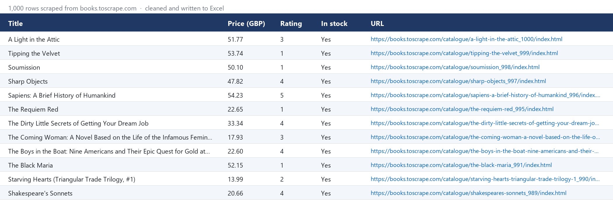

# Web Scraping Demo — 1,000 books → clean Excel

A small, polite scraper that turns a public catalogue page into a spreadsheet a
client can actually use. Built as a **working sample** for data-extraction jobs:
no login walls, no CAPTCHA bypass, no hidden tricks.

Target: [books.toscrape.com](https://books.toscrape.com/) — a public sandbox site
made for scraping practice.

## What it produces

| Title | Price (GBP) | Rating | In stock | URL |
|---|---|---|---|---|
| A Light in the Attic | 51.77 | 3 | True | https://books.toscrape.com/catalogue/a-light-in-the-attic_1000/index.html |
| Tipping the Velvet | 53.74 | 1 | True | https://books.toscrape.com/catalogue/tipping-the-velvet_999/index.html |
| Soumission | 50.10 | 1 | True | https://books.toscrape.com/catalogue/soumission_998/index.html |
| Sharp Objects | 47.82 | 4 | True | https://books.toscrape.com/catalogue/sharp-objects_997/index.html |

Cleaning applied on the way in:

- `£51.77` → `51.77` (number, not text)
- `star-rating Three` → `3` (integer, sortable)
- `In stock` → `True` / `False`
- relative links → absolute URLs, clickable in Excel
- header row frozen, auto-filter on, column widths set



## Run it

```bash
pip install -r requirements.txt
python scraper.py                 # all pages (~1,000 books, ~1 min)
python scraper.py --pages 3       # quick test
python scraper.py --out my.xlsx   # custom output name
```

Output: `books.xlsx` in the same folder.

## How it works

1. `fetch()` — GET with 3 retries and a 20 s timeout, so one flaky request does
   not kill the run.
2. `parse_page()` — one CSS selector per field (`article.product_pod` cards).
3. `clean_*()` — parse prices, ratings and stock into real types.
4. `next_page_url()` — follow the paginator until there is no `li.next`.
5. `write_excel()` — openpyxl with header styling, freeze panes, filters.

A 0.25 s delay between pages keeps the load on the server negligible. If the
site's markup changes, only the selectors in `parse_page()` need updating.

## Notes

- Public data only — this does not log in, bypass paywalls or solve CAPTCHAs.
- Respect the target site's `robots.txt` and terms before pointing this at a
  new URL.
- Tested on Python 3.11+ (Windows and Linux).

## Want this for your site?

I adapt the same pattern to product listings, real-estate portals, job boards or
directory pages — delivered as Excel/CSV plus a script you can re-run, with a
short video showing how to use it.
